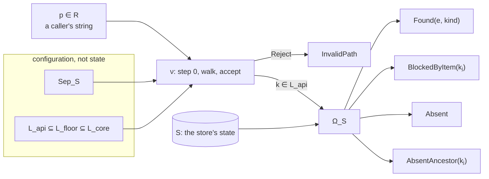

# Research: A key model between the store tree and the key parameter (BK-484)

**Date:** 2026-10-21
**Backlog items:** BK-484 (No key model connects spec 051's Key to the key parameter of `Store`)
**Status:** Research complete — ready for design decisions. The decisions of § 6 were taken by the maintainer through the interview (2026-10-21); the model is tested by a property-based spike and proved in Lean 4 (§ 10). Specified as [spec 052](../specs/052-store-key.md), which § 9.8 calls spec 054 (its number before RFC-0025 D6).

---

## 1. Problem Statement

[Spec 051](../specs/051-store-tree.md) defines Key on the entities of one
store at one instant; a caller passes a string. Nothing states what that
string denotes before any entity has it, which strings denote the same key,
or what lookup answers for a key no entity has.

Four existing clauses answer parts of this, each by its own rules: spec 004's
`RemotePath` normalises input, the kernel's key rule (BE-030, BK-389's
dossier, decision 6) refuses and normalises keys at the entry of a backend
on the kernel,
spec 053's BE-032 (from RFC-0021) resolves a Key against the tree, and spec
015 composes a child store's keys. They differ from one another (§ 9).

**Authority.** Only spec 051's TREE-001 to TREE-012 govern this model. Where
an existing clause or accepted RFC says otherwise (specs 004, 005, 015 and
053, RFC-0021, and spec 051's own § Layering, which names spec 004 as the
input layer's owner), the difference is recorded as a delta (§ 9, § 10), not
adopted.

This document states one model for the layer between a caller's string and
spec 051's Key, as definitions over spec 051's own terms, with no backend,
operation or encoding in it. It gives each rule a counterexample showing what
breaks without it (§ 5), lists what follows (§ 7), and records a
property-based spike and Lean proofs of every lemma (§ 10). The decision it
informs is the content of a spec between 051 and 004.

**What is claimed.** A caller's string is reduced, by the string alone and
the store's configuration, to at most one key string; two strings reducing to
the same one are equivalent, and each class of accepted strings holds exactly
one member of L_api, its canonical form (§ 3.5, § 4). Lookup then answers one of
four outcomes against the store's state (§ 3.7). Every key string the library
accepts is a key spec 051 admits and the kernel accepts (§ 4).

---

## 2. Notation and parameters

Spec 051's terms are used unchanged: Σ, Σ\*, ε, N, the store tuple
(U, F, I, r, C, name), chain (TREE-006) and Key (TREE-009). Names compare
exactly (spec 051 § Name equality).

| Symbol | Meaning | Depends on the store's state? |
|---|---|---|
| R | The strings a caller passes. | no |
| L_core | The **key strings**: every string that is the Key of some entity in some store (§ 3.1). | no |
| L_api | The key strings the library accepts, L_api ⊆ L_core (§ 3.2). | no |
| S | A store: a tuple as in spec 051 § Terms satisfying TREE-001 to TREE-008, at one instant. | is the state |
| K(S) | The Keys of S: { Key(x) │ x ∈ U_S }. | yes |
| kind(x) | folder for x ∈ F, item for x ∈ I; total and single-valued by TREE-001. | yes |
| Sep_S | The input separators of S: {`/`} or {`/`, `\`} (§ 3.3). | no, configuration |
| ν | Reduction: R → L_api ∪ {Reject} (§ 3.5). | no |
| ≈ | Parameter equivalence on R (§ 3.4). | no |
| Ω_S | Resolution: L_api → (U_S × kind) ∪ Miss (§ 3.7). | yes |
| k ⊕ p | Join: ν(k/p) for k ∈ L_api, p ∈ R (§ 3.5). | no |

**Σ** is instantiated as the Unicode scalar values: every code point except
the surrogates (§ 6). It contains `/` and other symbols, as spec 051 requires,
and every name over it is encodable as UTF-8.

**Examples** quote strings literally. `␀` stands for NUL (U+0000); every `\`
is a backslash, never an escape.

---

## 3. The model

The model has three layers, and only the last reads the store's state:

1. **Reduction** ν: R → L_api ∪ {Reject} (§ 3.3 to § 3.5). It reads the
   string and the store's configuration (Sep_S and the chosen L_api), never
   its state. It checks the raw input, walks away navigation and separator
   noise, rejects an escape, and judges where the walk ends.
2. **Key strings** L_api ⊆ L_floor ⊆ L_core (§ 3.1, § 3.2). L_core is
   TREE-011's Key shape. In one store, Key is a bijection between U_S and
   K(S) ⊆ L_core (TREE-010), so a key string names at most one entity.
3. **Resolution** Ω_S: L_api → (U_S × kind) ∪ Miss (§ 3.7), with four
   disjoint outcomes: Found, BlockedByItem, Absent and AbsentAncestor.

A child store adds no layer. It walks from its own root and resolves c ⊕ k
in S (§ 3.6).



### 3.1 Key strings

```
L_core = {ε} ∪ { s₁/…/sₙ │ n ≥ 1, every sᵢ ∈ N }
```

L_core is exactly TREE-011's Key shape, and it equals the union of K(S) over
all stores (Lemma C, § 4). **Key and key string differ:** spec 051 defines Key
on entities, so a key string is a Key **in S** exactly when it is in K(S). A
key string outside K(S), such as the target of a write not yet made, denotes
nothing in S, as TREE-009 says of every string that is no entity's Key;
resolution reports it as a Miss (§ 3.7).

The key parameter of `Store` and `AsyncStore` therefore takes R and is reduced
to L_api, never checked against K(S): only resolution reads the state.

### 3.2 Acceptance

Acceptance constraints come in two kinds. A **per-string** constraint judges
one key string alone and is a language; a **per-store** constraint judges a
set of names together and is a predicate on states.

**The floor.** Every store, whatever its backend, refuses a name holding NUL
or `\`, and a name equal to `.` or `..`. L_floor is what remains:

```
L_floor = { k ∈ L_core │ no segment contains NUL or `\`, and no segment equals `.` or `..` }
```

The NUL rule is a library choice, since spec 051 admits any symbol of Σ but
`/`. The `\` rule follows from § 3.3: `\` is a separator or rejected, never a
name character. The `.`/`..` rule is § 3.3's reservation. NUL and `\` are
enforced on the whole raw input (§ 3.5, step 0), not on the result.

**The tiers.** Each backend b accepts a language L_b ⊆ L_core, defined by
predicates on one string: per segment (control characters, `:`, wildcards,
reserved device names such as `CON`) and on the whole string (total length).
Length limits are stated in each backend's own unit, measured on the encoding
that backend uses (an S3 key in UTF-8 bytes, a Windows name in UTF-16 code
units). The portable language is what every supported backend accepts:

```
L_shared ⊆ L_b ⊆ L_core      for every backend b,
L_shared ⊆ ⋂_b L_b           (equal, or stricter as a deliberate policy)
```

*Superseded by spec 052:* there L_shared is a policy that names no backend,
so neither inclusion is promised (§ 9.8).

What each backend's own authority permits, with sources, is collected in
[research-backend-path-authorities.md](research-backend-path-authorities.md),
the input for each L_b. Its § 3.7 also records that the Azure Python SDK's
transport removes dot segments before sending, so a `..` that reached it could
address a blob outside the container; § 3.5's reduction removes navigation
before any key string reaches a backend.

**L_api** is L_floor ∩ L_b by default, so every key the backend can hold
under the floor stays reachable; a store may opt into portability, and then
L_api = L_floor ∩ L_shared. The choice is a declared, observable part of the
store's configuration.

**A backend that rewrites names** on storage has a function norm_b on N
(HFS+ stores NFD). Its language holds only the names it stores unchanged:

```
k ∈ L_b  only if  norm_b(s) = s for every segment s of k
```

A rewrite that depends on a name's position is taken at the last segment,
where it applies: every segment is the last segment of some prefix of k, k
itself included, and by TREE-012 every proper prefix is a folder's Key. So
L_b is prefix-closed: a key whose folder could not
itself be addressed is refused.

**Sibling equivalence.** A backend with a coarser name equality
(case-insensitive, normalising) has an equivalence ≡_b on N. It cannot be a
language: `A` and `a` are each acceptable and conflict only as siblings.
Spec 051 § Name equality states the consequence; as a predicate on states:

```
b represents S  iff  for every folder p, the names of p's children are pairwise distinct under ≡_b
```

It is checked when an operation would create the collision, not by ν. The
library never rewrites a name into a different key string.

**What the authorities imply for these rules**, by section of
[research-backend-path-authorities.md](research-backend-path-authorities.md):

- **Rewriting beyond HFS+.** Win32 normalisation removes the period from a
  segment ending in a single `.`, and all trailing periods and spaces from
  the last segment (its § 3.4). An Azure HNS
  account stripped a trailing `.` from the last segment of a raw path (its
  § 5, a measurement of that position only; Microsoft documents the rule only
  for Azure Files). By the normal-form rule, taken at the last segment, L_b
  refuses a name ending in `.` in every segment on Windows and on HNS, `...`
  included (HNS refused that PUT with `InvalidUri`), and on Windows also a
  name ending in a space. HNS's other rewrites never meet a key
  string: an empty segment and a leading or trailing `/` are outside L_core,
  whose segments are names, and `.`, `..` and `\` are outside the floor.
- **Coarser equality, not rewriting.** APFS is normalisation-insensitive, and
  case-insensitive by default, but stores names as written (its § 3.3), Windows
  is case-insensitive and case-preserving (its § 3.4), and Graph looks paths up
  case-insensitively (its § 3.9). These fall under sibling equivalence, not
  the normal-form rule.
- **A whole-string rule besides length: a segment count.** Azure caps a blob
  name at 254 segments on a flat account, and at 63 on an HNS account counting
  the account and container (its § 3.7).
- **The client layer.** Of the client libraries, only the Azure Python SDK was
  examined (its § 3.7). The model needs no guarantee from a client, since no
  key string carries navigation, but a listed name that another tool wrote
  does (BK-483).

### 3.3 Separators and the walk

**Separators.** The only separator in a key string is `/`. In a caller's
string, each store S has an input separator set Sep_S:

| Backend instance | Sep_S | Opt-out |
|---|---|---|
| treats `\` as a separator natively (e.g. local storage on Windows, an SFTP server on Windows) | {`/`, `\`} | — |
| any other | {`/`, `\`} by default | to {`/`}; a `\` anywhere in the input is then rejected (§ 3.5, step 0) |

Each backend instance declares its row, and Sep_S is observable: a caller can
always know whether `\` is read as a separator. How it is shown belongs to the
API, not to this model.

**The walk.** A caller's string is split on Sep_S and read from the root of
the store being called (for a child store, its own root), one segment at a
time. A position is a sequence of names; the empty sequence is the root.

| Segment | Step |
|---|---|
| a name other than `.` and `..` | down: append the name |
| exactly `..` | up: drop the last name; at the root, the walk **escapes** |
| exactly `.` | stay |
| empty (two adjacent separators, a leading or a trailing one) | stay |

**Navigation** is every step that is not *down*. A non-empty segment is
navigation only if it **equals** `.` or `..`: `a..b`, `...`, `.hidden` and
`..x` are names.
The walk is lexical: positions are names, not entities, so `f/..` returns to
the start whether `f` exists, is a folder or is an item. An escape is never
clamped. There is no other starting point: the store API has no working
folder.

Spec 051 (by `research-store-model-axioms.md` § 6) admits `.` and `..` as
names. Once they are read as navigation, an entity named `.` or `..` exists in
the model and is not addressable through `Store`. TREE-001 to TREE-012 are not
amended: spec 051's § Layering says the library addresses a subset of the Keys
they admit. That same paragraph names spec 004 as the input layer's owner,
which § 10's recommendation changes (a delta, § 10).

### 3.4 Parameter equivalence

Two strings are **equivalent**, p ≈ q, when neither is rejected at step 0
(§ 3.5), neither walk escapes, and both end at the same position.

- **Purely syntactic.** ≈ never compares names beyond exact equality: `A` and
  `a` end at different positions, as do differently normalised spellings.
- **Not the sibling equivalence of § 3.2.** ≡_b relates names under a
  backend's coarser equality and constrains states; ≈ relates strings and is
  defined by the walk. Neither implies the other.
- **Independent of the tiers.** A walk through a name a backend would refuse
  (`CON/../a`) is equivalent to the walk that skips it (`a`): acceptance
  judges only where the walk ends.

### 3.5 Reduction

ν checks the raw input, computes the walk's end position, then judges it:

0. **Input.** A NUL anywhere, or a `\` when `\` ∉ Sep_S, is Reject. These
   are rules on R: checked on the result instead, a `..` could remove the name
   holding them (§ 5).
1. **Walk.** § 3.3 from the root. An escape is Reject.
2. **Accept.** Join the position's names by `/` (ε for the empty position)
   and check the result as a whole against L_api, every segment predicate and
   every whole-string one. A failure is Reject; otherwise the result is a key
   string in L_api. Names popped during the walk are never checked.

**Join.** k ⊕ p = ν(k/p). The walk over k's segments ends at k, since k has
no navigation segment, and continues with p's; join inherits the walk, the
escape rule and acceptance, and needs no rules of its own.

**From here on, navigation is not part of the key string.** No string the
library hands to resolution has an empty, `.` or `..` segment.

Examples, for a store with Sep_S = {`/`, `\`} whose tier refuses `CON`:

| Input | ν | Class |
|---|---|---|
| `a/b`, `a//b`, `/a/b/`, `a/./b`, `a/c/../b`, `a\b`, `a\.\b` | `a/b` | one class |
| `` (empty), `/`, `.`, `a/..` | ε (the root) | one class |
| `a..b`, `.hidden` | the input | names, not navigation |
| `CON/../a` | `a` | the class of `a` |
| `..`, `/..`, `a/../..` | Reject (escape) | — |
| `x␀/..` | Reject (step 0) | — |
| `CON`, `a/CON` | Reject (step 2) | — |
| `A/b` | `A/b` | not equivalent to `a/b` |

After an opt-out (Sep_S = {`/`}), `a\b` and `a\a/..` are Reject at step 0.

### 3.6 Child stores

A child store of S at c, for c ∈ L_api (spec 015; c is the subpath reduced
by S's ν), answers by **composition**: when an operation runs, the child
resolves its key string k as S resolves c ⊕ k, and the operation maps that
outcome as § 3.7 does. So the child and S never disagree about one entity.
**At c = ε the child is S itself** (decided 2026-10-21): ε ⊕ k = k, so
`child("")`, `child(".")` and `child("x/..")` resolve every key as S does. Creating a child needs no
lookup, and its first write creates c and its missing ancestors in S, as the
same write to c ⊕ k in S would.

| Ω_S(c) when the operation runs | The child |
|---|---|
| Found(e, folder) | a store per spec 051 of its own: the subtree under e, with e as root and its name taken as ε (TREE-007); resolving in it agrees with S (K12) |
| Absent, AbsentAncestor | no store of its own: its root resolves as c does in S (no folder there), and every other key as AbsentAncestor |
| Found(e, item), BlockedByItem | no store of its own: its root resolves as c does in S, and every other key as BlockedByItem, so a write is `InvalidPath`, a read `NotFound` and a probe false (§ 3.7) |

In the last two rows, the kⱼ that AbsentAncestor and BlockedByItem carry is a
proper prefix of c (only Found(e, item) has kⱼ = c, the child's ε), so it has
no spelling among the child's keys. What the child reports for it, its own
root, no key, or S's key on purpose, is not decided here (§ 10).

Keys compose by join: a child key string k is S's key string c ⊕ k.
**Chaining** holds for a d the child accepts: if ν_c(d) ≠ Reject, then
child(c).child(d) = child(c ⊕ ν_c(d)) (CHILD-005). A d that reduces to ε,
such as `.`, gives child(c) itself, since c ⊕ ε = c. A d the child rejects
creates no grandchild: under c = `a`, `../b` escapes the child, although S
accepts c ⊕ `../b` = `b`.
Walks start at the child's root, so a child never reaches the rest of S,
though an outcome's kⱼ can name it (above).
**Acceptance runs on the composed string:** a whole-string limit applies to
the backend's key, so a k that passes alone can fail under c. Sep_S and L_api
are S's.

### 3.7 Resolution

For k ∈ L_api with segments s₁, …, sₙ (n ≥ 0) and prefixes kᵢ = s₁/…/sᵢ
(k₀ = ε), let j be the largest i ≤ n with kᵢ ∈ K(S), and e the entity with
Key kⱼ (unique by TREE-010). j exists because k₀ = Key(r), and every kᵢ with
i ≤ j is a Key too (TREE-012).

| Case | Outcome | What an operation can do |
|---|---|---|
| j = n | **Found**(e, kind(e)) | read, list, delete; the operation checks the kind it needs |
| j < n, e ∈ I | **BlockedByItem**(kⱼ) | nothing below k can exist: an item contains nothing (TREE-003) |
| j = n − 1, e ∈ F | **Absent** | create k in place |
| j < n − 1, e ∈ F | **AbsentAncestor**(kⱼ) | create k only by also creating kⱼ₊₁ … kₙ₋₁ |

A Miss is one of the last three. The four are disjoint and exhaustive. Spec
053's BE-032 A.1 resolves a Key to `Item`, `Folder` or `Nothing` and states
that resolutions carry no depth: Absent and AbsentAncestor are both its
`Nothing`, and BlockedByItem is its `Nothing` with the item travelling for the
message. Telling Absent from AbsentAncestor is a delta (§ 9.6). Ω_S(ε)
is Found(r, folder) in every store (TREE-002, TREE-009); whether an operation
accepts the root is that operation's predicate, not ν's. The kernel's root row
(BK-389's dossier, decision 6) is one such set of predicates.

**Outcomes as errors.** The model fixes outcomes, not exceptions; whether an
outcome is an error is the operation's decision. Where it is one:

| Outcome | Error | Spec 005 |
|---|---|---|
| Reject: step 0, escape, the floor, a tier | `InvalidPath` | ERR-005 (a) |
| Found, but the operation needs the other kind | `InvalidPath` | ERR-005 (b) |
| BlockedByItem, in an operation that would create below the item | `InvalidPath`, as BE-032 A.4 and A.5 already answer | ERR-005 (b), widened: the key *or one of its prefixes* names the wrong kind |
| Absent or AbsentAncestor, in an operation that needs the entity | `NotFound` | ERR-002 |
| BlockedByItem, in an operation that needs the entity (a read, a delete); a probe answers false and a listing is empty | `NotFound`, as BE-032 A.5's "path through an item" row | ERR-002 |
| AbsentAncestor, in a write | none: the write creates the missing folders | as ERR-005's own example |
| A sibling clash under ≡_b: writing `a` beside an existing `A` | `AlreadyExists`; `path` is the caller's key, the message names the existing sibling | ERR-003, widened to a clash under the backend's name equality |

---

## 4. Derived definitions and consequences

**Operations on key strings.** For k = s₁/…/sₙ ∈ L_core (n = 0 exactly when
k = ε), each a function of the string alone; the last column holds whenever k
is a Key in S.

| Operation | Definition | Agrees with spec 051 |
|---|---|---|
| segments(k) | (s₁, …, sₙ); segments(ε) = () | for k = Key(x), the names along the chain of x, the root excluded (TREE-009) |
| prefix kᵢ | s₁/…/sᵢ for 0 ≤ i ≤ n | for k = Key(x) and 0 < i < n, the Key of a folder on the chain of x (TREE-012); k₀ = Key(r) |
| last(k) | sₙ for n ≥ 1; last(ε) = ε | last(Key(x)) = name(x) for every x, the root included (TREE-007) |
| parent(k) | kₙ₋₁ for n ≥ 1; undefined for ε | parent(Key(x)) = Key(p), p the one container of x (TREE-004, TREE-006); parent(`a`) = ε |
| k ⊕ p | ν(k/p) | — (input side) |

**Lemma C (universality).** L_core = ⋃_S K(S). ⊇ is TREE-011. ⊆: for
s₁/…/sₙ, the store of r, one folder per proper prefix and one entity of
either kind for the whole string, chained in order with name(xᵢ) = sᵢ,
satisfies TREE-001 to TREE-008 (every folder has at most one child, so
TREE-008 holds vacuously) and has the string as a Key. So L_core is the
store-independent type and K(S) its store-dependent subset.

**Canonical fixed point (the round trip).** ν(k) = k for every k ∈ L_api, ε
included: k has no navigation segment and passes step 2. Every key string the
library hands out reduces to itself when passed back, and each class of
accepted strings holds exactly one member of L_api, its canonical form. A
display spelling of the root such as `.` also round-trips, because ν(`.`) = ε.

**The library's keys are the kernel's.** L_api minus ε lies inside the set of
keys the kernel lists and passes, BE-030's `Canonical` in
[`BackendContract.dfy`](../formal/BackendContract.dfy) § 5a (non-empty; no
NUL, `\` or leading `/`; no empty, `.` or `..` segment), which is also the
non-root part of `WellFormedPath` there: L_floor's segment rules are those
clauses, and TREE-011's shape excludes the empty segments. So no key the
library accepts is refused or rewritten by the kernel's key rule.
(Derivation: the clauses of `WellFormedPath` and `Canonical`, read against
L_floor's definition and TREE-011, 2026-10-21.)

---

## 5. Why each rule is there

Each row removes one rule and gives an input on which the model then breaks
a claim of § 7. The first two rows were found by the spike (§ 10); the rest
were found while deciding § 6.

| Rule removed | Input | What goes wrong |
|---|---|---|
| Step 0's `\` rule on the raw input (checking `\` on the result instead) | `a\a/..` | ε after an opt-out, `a` by default: the opt-out changes what an accepted input means, so K5 fails. |
| Step 0's NUL rule on the raw input | `x␀/..` | Accepted as ε: a string carrying NUL denotes the root. |
| Acceptance on the end position only (checking each *down* step instead) | `CON/../a` | Rejected, although ≈ makes it equivalent to the accepted `a`: ν no longer decides ≈ (K3). |
| Escape rejected (clamping at the root instead) | `../x` at the root | Means `x`: a mistaken path silently addresses an entity. |
| One starting point, the store's root (a general base b instead) | `..` from base `x/y` | Two readings: escape at b, or climb through b to the root. A draft of this model stated both. |
| `\` never a name character (a literal mode instead) | `a\b` | One string, two meanings across stores; and folding a stored `d\f` meets `d/f`, the collision BK-395 measured on Memory. |
| Names only in the backend's normal form (rewriting into it instead) | NFC `é` on HFS+ | Written as NFC, listed back as NFD: the listed string is not the key written, and two spellings denote one entity, a second spelling TREE-009 forbids. |
| Sibling equivalence as a state predicate (a language filter instead) | `A` beside `a` | Each passes any filter alone; the conflict exists only in a store holding both. |
| Acceptance on the composed string for a child (on the child-relative string instead) | `abc` under child `xyz`, total length limit 5 | Accepted although the backend's key `xyz/abc` exceeds the limit. |
| The child read when an operation runs (checked once at creation instead) | a child at `c`, after `c` is replaced by an item | The creation-time check needs a lookup, and its answer goes stale with the state. |
| BlockedByItem apart from Absent | a write to `f/x`, `f` an item | Reported like a missing parent, although no write can succeed there (K11). |

---

## 6. Decisions taken

Taken by the maintainer through the interview, 2026-10-21; each dialog is in
the session's decision log (`sdd/decisions/`, listed in the BK-484 trace).

| Decision | Chosen | Alternative and what it would change |
|---|---|---|
| Navigation | Supported in the caller's string, reduced before the key string | None: callers resolve relative paths themselves. Or reserve `.`/`..` without reducing them. |
| `..` above the root | Reject | Clamp at the root, as `posixpath.normpath` and RFC 3986 do (§ 9): never fails, may address the wrong entity. |
| Separator noise (`//`, leading and trailing `/`) | Collapsed: equivalent to the clean string | Rejected: one spelling per key on input too. |
| `\` | A separator by default; forced where the backend instance treats it natively; an opt-out rejects it anywhere in the input; never a name character | A literal mode keeping `\` in names: reaches S3 and Azure names holding `\`, at the cost of one string meaning different keys per store. |
| The root's key string | ε, by spec 051; display out of this model's scope | Mandate ε for display too: spec 004's printed `.` (PATH-015's `str()`) becomes a defect. |
| Where step 0's rules apply | The whole raw input | The end position: § 5's first two rows. |
| What step 2 judges | The end position only | Each *down* step: § 5's third row. |
| Error for BlockedByItem in a write | `InvalidPath`, widening ERR-005 (b); BE-032 A.4 and A.5 already give the same answer | `NotFound`, hiding that something exists at the prefix; or a new class with its own ADR. |
| Error for a sibling clash under ≡_b | `AlreadyExists`, widening ERR-003 | `InvalidPath`, a lexical-sounding error for a state conflict; or leave it to BE-032. |
| A child at an absent or item c | Lazy and by composition: it answers what S answers at c ⊕ k, and is a store of its own only at a folder c | Must exist: `child()` needs a lookup, and multi-tenant setups create folders first. Or a view of its own (a one-entity store, or raising on every operation), whose root then disagrees with S. |
| A backend that rewrites names | Accept only names in its normal form | The backend returns the written spelling, needing extra state; or leave it to BE-032. |
| Σ | Unicode scalar values | Bytes, reaching non-UTF-8 POSIX names; or all code points, surrogates included. |
| Length units | Each backend's own | One library unit, with conservative conversions. |
| L_api | The backend's language by default; portable by opt-in | Portable by default, stranding existing names outside L_shared; or no portable mode. |
| Where the model is specified | A new spec between 051 and 004, after this document | Amend spec 004, mixing a model with a value object's API; or extend spec 051, against its scope "structure only". |

**Costs the decisions accept.** A name holding `\`, NUL, or one equal to `.`
or `..`, or one outside a backend's normal form or Σ, can exist in a backend
and is not addressable through `Store`. On a class on the kernel, for keys the
kernel's rule refuses or rewrites, BE-030 already says what a listing does: it
omits them, logs them, and leaves them reachable through addressing and
`unwrap()`. Only Memory is on the kernel so far (the files under
`src/remote_store/backends` that import the kernel are `_memory.py` and
`_memory_tree.py`), so on every other backend no clause says what a listing
yields for such a name; BK-483 is that case on Azure. Names this model refuses
beyond the kernel's rule (a tier, a normal form) have no such clause on any
backend (§ 10).

---

## 7. Lemmas

All are proved in Lean 4 (§ 10); the theorem names are in its table.

- **K1, output shape.** ν(p) = k implies k is the `/`-join of names, each
  free of `/`, `\`, NUL and navigation, so k has TREE-011's shape.
- **K2, canonical fixed point.** ν(k) = k for every k ∈ L_api.
- **K3, ν decides ≈.** For accepted p and q, they walk to the same position
  iff ν(p) = ν(q).
- **K4, join is walk continuation.** If k ⊕ p is accepted, then
  (k ⊕ p) ⊕ q = k ⊕ (p/q).
- **K5, an opt-out only rejects more.** If ν accepts p with Sep_S = {`/`},
  it accepts p with the same result when Sep_S = {`/`, `\`}.
- **K6, child composition.** For c ≠ ε, a child key k accepted under c is the
  parent's c ⊕ k, and the parent accepts the composed string with that
  result. At c = ε the child is S itself (§ 3.6), so K6 holds there by
  definition.
- **K7, segments.** segments(Key(x)) is the names along the chain of x.
- **K8, last and parent.** last(Key(x)) = name(x); parent(Key(x)) is the Key
  of x's container.
- **K9, Lemma C.** Every key string is a Key in some store, as a folder and,
  when non-empty, as an item.
- **K10, resolution.** Occupied prefixes are closed downward; j exists; j = n
  iff k is a Key in S; one of the four outcomes holds.
- **K11, nothing below an item.** No Key extends an item's Key.
- **K12, the child view.** The child at a folder is a store per spec 051,
  whose entities are the parent's below e with keys composed by join and
  kinds kept.

---

## 8. Non-goals

- Operations and state change: what a write, move or delete does to S, and
  the "create in place" column of § 3.7.
- How a backend encodes the tree (BE-032), and `glob` patterns (BK-389's
  dossier, decision 6).
- How a key string is displayed, including the root printed as `.` (PATH-015's
  `str()`); PATH-015's `name` and `parts` are a delta (§ 9.2).
- The shape of the API: which type carries a key, and how Sep_S and the
  portability choice are configured and shown.

---

## 9. Comparison with the existing layers and well-known models

**Verification status** per claim: *Measured* (run in this session, the
command named), *Read* (from the named file), *Textbook* (a standard fact
not checked against one cited text).

### 9.1 At a glance

| Model | `..` | `.` and empty segments | `\` | NUL | The root | Above the root |
|---|---|---|---|---|---|---|
| **This model** | climbs | skipped | separator, or rejected after an opt-out | rejected | ε, accepted; the operation decides | rejected |
| Spec 004, `RemotePath` (*Read*, *Measured*) | rejected (PATH-003) | removed (PATH-005, PATH-006) | converted to `/` (PATH-002) | rejected (PATH-007) | rejected as input (PATH-008); sentinel printed `.` (PATH-015) | — |
| Kernel key rule, BE-030 and decision 6 (*Read*) | rejected | dropped | rejected | rejected | `""`, answered per operation group | — |
| Spec 015, `child()` (*Read*) | rejected (CHILD-003) | via `RemotePath` | via `RemotePath` | rejected | an empty subpath rejected (CHILD-001) | — |
| `posixpath.normpath` (*Measured*) | climbs | collapsed | an ordinary character | — | `/` | clamped (`/..` → `/`); a relative path keeps the `..` (`a/../..` → `..`) |
| `ntpath.normpath` (*Measured*) | climbs | collapsed | separator (output uses `\`) | — | drive root | clamped (`C:\..` → `C:\`) |
| RFC 3986 § 5.2.4, `remove_dot_segments` (*Textbook*) | climbs | `.` removed | — | — | `/` | clamped |
| POSIX pathname resolution (*Textbook*) | physical: follows the directory entry, after links | `.` stays; empty segments collapse | an ordinary character | not in a path | `/` | `/..` is `/` |
| ZooKeeper `PathUtils.validatePath` (*Read*, § 9.7) | rejected | rejected, as is a trailing `/` | an ordinary character | rejected | `/` | — |

The measured rows: `RemotePath` on `a/c/../b` (`InvalidPath`), `a\b`
(`a/b`), `/a/b/` and `a/./b` (`a/b`); `posixpath` and `ntpath` on the inputs
shown; all with `hatch run python -I`, Python 3.13.16, 2026-10-21.

### 9.2 Spec 004 (`RemotePath`)

`RemotePath` is a canonicalisation function of this kind, a stricter variant
of ν: it agrees on separator noise and `.`, and on `\` as a separator by
default. It differs in three places, each a delta for the spec to settle:
`..` (PATH-003 rejects every `..`; ν climbs), the root (PATH-008 rejects the
empty path; PATH-015's `name` and `parts` give the root the name `.` and parts
`(".",)`, where spec 051 has name(r) = ε and no segments; PATH-010 gives `a` no
parent, where § 4 has ε), and the opt-out, which spec 004 does not have.
PATH-015's `str()`, printing the root as `.`, is display and out of scope
(§ 8).

### 9.3 The kernel's key rule

The kernel refuses a leading `/`, a `..` segment, NUL and `\` at the backend's
entry, then drops empty and `.` segments (BK-389's dossier, decision 6, which
BK-395 completed). It sits below this model and agrees with it: § 4 shows the
library's keys are inside the kernel's domain, so a key reduced by ν passes
the kernel unchanged. Its per-operation root table is one instance of § 3.7's
"the operation decides". Its addressing (`native_path`, `resolve`) passes a
refused key raw, which is why, on a class on the kernel, a stored key this
model cannot address stays reachable through addressing (§ 6, costs).

### 9.4 Spec 005 and spec 015

Spec 005 has an error for every outcome but two, each a widening (§ 3.7):
ERR-005 (b) to a prefix of the wrong kind, ERR-003 to a clash under ≡_b. Two
deltas, both in ERR-005 (a)'s preconditions: a path "that normalizes to
empty" is an error, where ε is a key string here and the operation decides;
and a path containing `..` is an error (its example: `foo/../bar`), where ν
reduces it to `bar` and accepts it. Spec 015 agrees on
composition (CHILD-005) and the round trip (CHILD-009); it differs on `..`
(CHILD-003, as PATH-003) and the empty subpath (CHILD-001 rejects it; here a
child at ε is the store itself, § 3.6), and does not say what a child at an
absent or item c is.

### 9.5 Path normalisers

The common normalisers clamp at an absolute root; this model rejects (§ 5).
`posixpath` also keeps a leading `..` on a relative path, which has no
counterpart here: every key parameter is relative to its store's root, so
such a `..` escapes. POSIX resolution is physical, following the entry a
name denotes; this model is lexical, which is sound only because spec 051 has
no links.

### 9.6 Spec 053's BE-032 and RFC-0021

BE-032 lands RFC-0021's Appendix A (accepted, BK-432) and is the accepted
authority for what a Key resolves to on the kernel (*Read*, spec 053 BE-032
A.1 to A.5; RFC-0021 D0, D1, D4, D5). RFC-0021 D0 puts how an input becomes a
Key out of its scope, so the two meet only at the Key.

- **Agrees.** A Key names at most one entity (A.1, TREE-010); writing below an
  item, or an item over a folder, is `InvalidPath` (A.4, D4; § 3.7's
  BlockedByItem row and its Found-with-the-other-kind row); on a class on the
  kernel, a stored key holding `\`, `..` or NUL is outside the library's
  addressable subset, omitted from listings and reached through addressing
  and `unwrap()` (A.2, BE-030; § 6, costs).
- **Delta: depth.** A.1 resolves to `Item`, `Folder` or `Nothing` and states
  "Resolutions carry no depth", since `ensure_parents(key)` creates every
  missing folder from the key alone. § 3.7 tells Absent from AbsentAncestor by
  j.
- **Delta: the input layer's owner.** A.1 ("A Key is not a caller's input")
  names spec 004's `RemotePath` as the layer mapping input onto a Key, and
  A.2 attributes the refusal of `..` to PATH-003; ν climbs `..` (§ 3.3).
- **Open there, answered here for writes only.** A.1 leaves undecided how a
  case-insensitive or normalising encoding answers; § 3.2's sibling
  equivalence and normal-form rule, and § 3.7's `AlreadyExists` for a clash
  on a write, are one answer for the write side. What a read, probe or delete
  answers when only a sibling equal under ≡_b exists, and whether a write
  with `overwrite=True` still clashes, stay open (BK-436 holds the decision).

### 9.7 Prior art

Three known structures sit under this model. Each is checked against the
source named, and each is narrower than the model.

- **Tries** (*Read*). A prefix-closed set of name sequences is a rooted tree
  whose edges are names, not characters. That is spec 051's L6, `ofTrie` in
  [`StoreAxioms.lean`](../formal/lean/StoreAxioms.lean) § 7. K(S) is such a
  set (TREE-012), and two of the Lean proofs go through it (§ 10).
- **Path-keyed tree maps** (*Read*).
  [`StoreTree.dfy`](https://github.com/haalfi/remote-store/blob/frozen/kernel-driver/sdd/formal/StoreTree.dfy) § 1 states the tree as
  `map<Key, Kind>`, valid when the root is a folder and every proper prefix of
  a key is a folder. Its § 2 `Resolve` answers `RItem`, `RFolder`,
  `RThroughItem` or `RNothing`. That is § 3.7 with Absent and AbsentAncestor
  merged, the depth delta of § 9.6.
- **ZooKeeper's namespace** (*Read*: the Programmer's Guide and
  `PathUtils.validatePath`, 2026-10-22). Paths are "canonical, absolute,
  slash-separated", with "no relative reference". The validator refuses
  where ν reduces: it rejects an empty path, a missing leading `/`, a trailing
  `/`, an empty node name, a `.` or `..` segment, NUL and several
  code-point ranges. A name such as `a..b` passes. This is § 6's rejected
  alternative for separator noise ("one spelling per key on input too"). Its
  nodes carry data and children at once, so it has no folder/item partition
  (TREE-001), and nothing like BlockedByItem arises.

### 9.8 Spec 054 as proposed (PR #1171, not merged)

*Superseded:* this compares the draft of 2026-10-22. Spec 052, the spec
that draft became, takes the model's side on the three points below: `..` climbs and only an
escape is refused, the `\` opt-out is KEY-009, and resolution is KEY-013.
It departs from the model in two places. Its KEY-002 also refuses a
surrogate anywhere in the raw input: § 3.5 step 0 refuses only NUL and an
opted-out `\`, and the model's inputs range over Σ, which holds no
surrogate (§ 2), so it says nothing of `\ud800/..`, which spec 052 refuses
rather than walking to ε. And its
L_shared is a policy `PORTABLE_KEY` defines, which no backend is promised to
hold, where § 3.2 has L_shared ⊆ L_b for every backend; under the opt-in a
store accepts its backend's declared portable set P_b ⊆ L_shared ∩ L_b, a
smaller P_b being a declared deviation, and a profile table beside the spec
records each backend's.

PR #1171 proposes spec 054, "Store Key Specification" (*Read*: its branch,
2026-10-22). It moves PATH-002 to PATH-007 out of spec 004 and adds KEY-001 to
KEY-009. It is the spec § 10 recommends, written in parallel, and it agrees on
most of the model:

- `\` is a separator (PATH-002).
- Empty and `.` segments contribute nothing (PATH-004 to PATH-006).
- ε is a Key that folder-shaped operations accept, which is one choice of
  § 3.7's "the operation decides" (KEY-005).
- A refusal inspects the whole raw input (KEY-003, as § 3.5 step 0).
- Backends admit a portable floor and refuse more only under a declared
  profile (KEY-007, KEY-008), one shape for § 3.2's tiers.
- KEY-009's one-to-one admission serves the same end as § 3.2's normal-form
  rule: no two key strings share one stored name.

It differs in three places:

- **`..`.** PATH-003 refuses every `..` segment, and spec 054's Notes say "A
  `..` segment is refused, never resolved against its parent". § 6 decides that `..` climbs and only
  an escape is refused (§ 5's escape row). The maintainer keeps § 6's
  decision, so this is a delta for spec 054 to take, not for this model.
- **The `\` opt-out.** Spec 054 has none.
- **Resolution.** Spec 054 states no lookup outcomes; § 3.7's four remain this
  model's own.

---

## 10. Results and recommendation

**Spike (2026-10-21).** [`bk-484-key-model/spike/`](bk-484-key-model/README.md)
is an executable model of § 3 and Hypothesis property tests of § 7's claims,
up to 2000 generated examples per property (its `settings` profile), over
small name pools chosen so collisions and navigation are frequent, and over
generated stores of at most ten entities. It found one defect: the `\` and
NUL rules were checked on the result, giving § 5's first two rows; the fix is
step 0. Run as the folder's README says, it reports `45 passed`.

**Lean 4 (2026-10-21).** [`bk-484-key-model/lean/`](bk-484-key-model/README.md)
proves K1 to K12 with Lean 4.34.1, core library only, against spec 051's own
definitions: it imports `join`, `join_inj`, `join_shape`, `seqOf`, `Key` and
L6's `ofTrie` from [`StoreAxioms.lean`](../formal/lean/StoreAxioms.lean)
rather than restating them. Two results go through L6: Lemma C builds the
store from the trie of one sequence's prefixes, and the child view is the trie
of positions below a folder. A `#guard_msgs` block pins the axioms of every
theorem the table below names, 15 in all, to Lean's standard ones, so a
`sorry` fails the build. A
mutation check, not committed, disabled step 0's `\` rule: the build failed,
with the opt-out and the dependent proofs no longer checking and the
`a\a/..` example evaluating to the wrong result.

| Lemma | Theorem | File |
|---|---|---|
| K1 | `nu_output`, `nu_key_shape` | `KeyConcept.lean` |
| K2 | `nu_fixed_point` | `KeyConcept.lean` |
| K3 | `nu_decides_equiv` | `KeyConcept.lean` |
| K4 | `join_continuation` | `KeyConcept.lean` |
| K5 | `opt_out_only_rejects_more` | `KeyConcept.lean` |
| K6 | `child_compose` | `KeyConcept.lean` |
| K7 | `segments_key` | `KeyStore.lean` |
| K8 | `name_eq_last`, `parent_eq_dropLast` | `KeyStore.lean` |
| K9 | `lemma_C` | `KeyStore.lean` |
| K10 | `occupied_take`, `resolution` | `KeyStore.lean` |
| K11 | `item_has_no_extension` | `KeyStore.lean` |
| K12 | `child_view` | `KeyStore.lean` |

**What neither covers.** Backend tiers are an arbitrary predicate in Lean and
stand-ins in the spike (`CON`, a byte limit), not real rule sets. Resolution's
four outcomes are proved to cover every case; their disjointness is stated,
following from arithmetic and TREE-001, not proved as a theorem. A child at
an absent or item c answers by definition from S (§ 3.6); only the folder case,
where the child is a store of its own, is a theorem (K12). § 3.7's state
changes are not modelled. Neither tool
runs in CI (BK-462), so both are review aids: no clause they check is
model-governed.

**Recommendation.** Specify the model as a new spec between 051 and 004,
owning key strings, acceptance, ν, ≈ and resolution; spec 004 becomes one
realisation of ν, and specs 005, 015 and 053 link to it. The spec settles
these deltas and open points:

- PATH-003, CHILD-003, ERR-005 (a)'s `..` clause and BE-032 A.2's attribution
  of the `..` refusal: `..` climbs. Spec 054 as proposed kept PATH-003 (§ 9.8);
  spec 052 climbs (KEY-003, KEY-004).
- BE-032 A.1: resolution's depth (Absent against AbsentAncestor), and its
  naming of spec 004 as the input layer's owner; spec 051's § Layering names
  spec 004 the same way.
- PATH-008, PATH-010, PATH-015's `name` and `parts` and ERR-005 (a): ε is a
  key string; the root's name is ε and its segments empty; `parent(a)` is ε;
  the operation decides whether it accepts the root.
- CHILD-001: a child at ε is the store itself (§ 3.6), where CHILD-001 rejects
  an empty subpath.
- ERR-005 (b) and ERR-003: the two widenings of § 3.7.
- The `\` opt-out and the portability opt-in: new configuration.
- What a listing does with a stored name this model refuses beyond the
  kernel's rule, on every backend, and with any name it refuses on a backend
  not yet on the kernel, where BE-030 does not apply (BK-483 is the Azure
  case) (§ 6, costs).
- What a child at an absent or item c reports for an outcome whose kⱼ lies
  above its root, which reaches the `path` and message an error carries
  (§ 3.6; spec 005).

---

## 11. Sources

- RFC 3986, "Uniform Resource Identifier (URI): Generic Syntax", § 5.2.4
  Remove Dot Segments (*Textbook* in § 9; not re-read in this session).
- POSIX.1, Base Definitions § 4.13 Pathname Resolution (*Textbook* in § 9;
  not re-read in this session).
- Apache ZooKeeper, "ZooKeeper Programmer's Guide", § ZNodes
  (<https://zookeeper.apache.org/doc/current/zookeeperProgrammers.html>), and
  `PathUtils.validatePath`
  (<https://github.com/apache/zookeeper/blob/master/zookeeper-server/src/main/java/org/apache/zookeeper/common/PathUtils.java>),
  read 2026-10-22 (§ 9.7).
