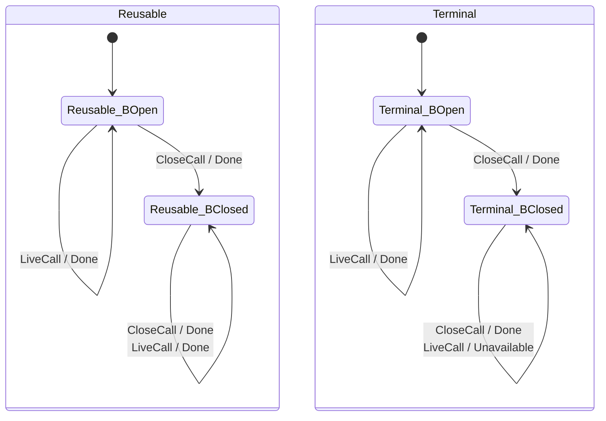
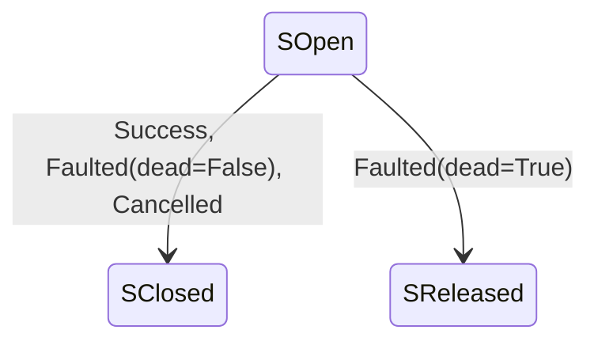
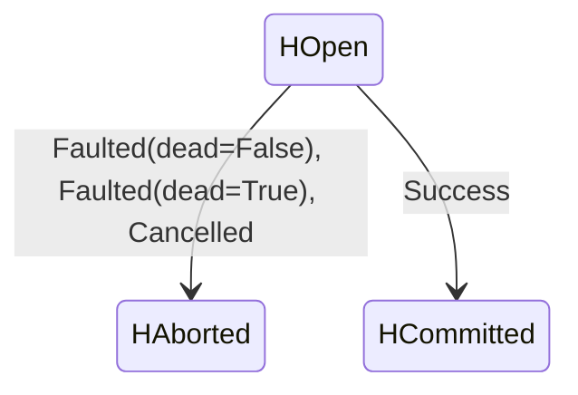
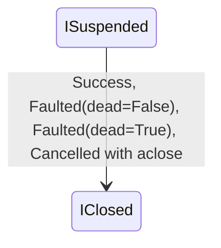

# 052: Backend Lifetime Specification

## Overview

What holds across a backend's calls: what `close()` does to the calls after
it, what one instance shared between threads guarantees, and, on the contract
kernel, what each call leaves open, closed or released when it exits. These are
lifetime clauses ([`SPEC-DESIGN.md` Rule 2](../SPEC-DESIGN.md#kind-of-truth)):
a witness of a breach is a sequence of calls on one object.

Scope: every backend's close posture (BE-020) and concurrent-use posture
(BE-028); for a class on the kernel, a repeated close (BE-034), the cleanup on
every exit (BE-033, BE-035, BE-036), a read after close (BE-037), and the
driver's lifetime duties (BE-038, BE-039). Out of scope, with the spec that
owns it:

- one call's outcome against the state when it runs:
  [spec 003](003-backend-adapter-contract.md), and for the kernel's single
  calls, its driver's single-call duties included,
  [spec 053](053-contract-kernel.md);
- a `Store` shared across threads (STORE-007), and when a refusal surfaces at
  a `Store` call: [spec 001](001-store-api.md) and, for `AsyncStore`,
  [spec 029](029-async-store-backend-api.md);
- the async posture (ASYNC-094) and the sync adapter's close (ASYNC-083,
  ASYNC-088): [spec 029](029-async-store-backend-api.md);
- whether a stream's close is skipped on a condemned connection (SIO-010):
  [spec 006](006-streaming-io.md);
- what a store holds after a reusable close: each backend's own spec.

## Terms

- **Class on the kernel**, **driver**: as
  [spec 053 § Contract kernel](053-contract-kernel.md#contract-kernel) defines
  them.
- **Live operation**: every member of a backend except the addressing members
  (`native_path`, `to_key`, `resolve`), `name`, `capabilities`, `close` and
  `unwrap`.
- **Capability gate**: the refusal with `CapabilityNotSupported` of a whole
  call whose capability the class does not declare, by the declaration alone:
  `ATOMIC_WRITE` (BE-011), `GLOB` (BE-024), and on the kernel `MOVE` and `COPY`
  (BE-030's **Gates around the pipeline**). WR-010's refusal of `metadata` for
  want of `USER_METADATA` depends on an argument, is not one, and ranks after
  the closed guard (BE-008, BE-030).
- **Closed guard**: after a terminal close, the refusal with
  `BackendUnavailable` of every live operation and, on a class on the kernel,
  of `unwrap` too (BE-020).
- **Close posture**, `close_is_terminal`: as BE-020 defines them.
- **Concurrent-use posture**, `thread_safe`, `single_connection`: as BE-028
  defines them.
- **Exit**: the end of a call as the kernel observes it, by a return, a raised
  error or a cancellation.
- **`connection_dead`**: the driver's predicate over a failure.
  `connection_dead` means transport-level death, the socket or session gone,
  never an error the next request on the same connection survives.
- **Condemned**: a failure `connection_dead` judges a transport-level death of
  the connection.
- **Temp-and-rename write**: a write the kernel makes by putting a temporary
  and renaming it onto the target ([spec 053](053-contract-kernel.md)).

---

## Sections

### BE-020: close()

**Invariant:** a backend's close posture, its `close_is_terminal` class
attribute (`False` unless the class sets it), decides what follows `close()`: a
terminal backend refuses every later live operation with `BackendUnavailable`,
and a reusable one never refuses a call for being closed.

| Call after `close()` | `close_is_terminal = False` | `close_is_terminal = True` |
|---|---|---|
| a live operation | not refused for being closed: answered by its own clause against what the store holds after the close | `BackendUnavailable`, with no side effect |
| a call a capability gate refuses | `CapabilityNotSupported` | `CapabilityNotSupported` |
| `unwrap` | not refused for being closed | on a class on the kernel, `BackendUnavailable`; on any other class, not refused by this clause (BE-022) |
| `close`/`aclose` | accepted again | accepted again |
| `name`, `capabilities`, the addressing members | answered | answered, never refused |

- **Precedence.** A capability gate outranks the closed guard, since
  capability data is not a live operation, and the closed guard outranks every
  other answer of a live operation, the root's and a key's refusal included.
- **When it binds.** On a terminal backend, a call that begins after
  `close()` begins is refused, whether or not `close()` has returned.
- **Nothing leaves Closed.** Under `close_is_terminal = False` the backend
  takes calls again but stays Closed; its next call re-initialises what the
  close released.
- **Who declares it.** `close()` need not be overridden: the base class's does
  nothing. On a class on the kernel the posture is its driver's
  `close_is_terminal`. Every backend takes one of the two postures except the
  sync adapter `AsyncBackendSyncAdapter`, whose close ASYNC-083 owns.

### BE-028: Concurrent-Use Posture

**Invariant:** every backend instance has one of two concurrent-use postures,
`thread_safe` unless its backend's spec declares it `single_connection` for
that instance's configuration, and the posture fixes what calls from several
threads on that one instance get.

| Posture | Calls from several threads on one instance | A remedy that works |
|---|---|---|
| `thread_safe` | raise nothing a lone call would not; writes to distinct keys all land; a read returns content a completed write left | — |
| `single_connection` | no guarantee | one instance per thread, or the caller serialising every call with one external lock |

No backend makes a sequence of calls atomic as one, and concurrent callers get
no order. Whether one operation is atomic is its capability's (`ATOMIC_MOVE`,
`ATOMIC_WRITE`, [spec 003](003-backend-adapter-contract.md)).

**See also:** [001-store-api.md](001-store-api.md) (STORE-007),
[013-memory-backend.md](013-memory-backend.md) (MEM-025/026),
[029-async-store-backend-api.md](029-async-store-backend-api.md) (ASYNC-094).

### BE-033: Interaction Protocol on the Kernel

**Invariant:** on every exit, a class on the kernel leaves no write handle
open, every read stream it opened closed or, when the failure condemned the
connection, released without a close, and no caller's async content iterator
it took suspended, when that iterator has `aclose`. The one stream an exit
leaves open is the one a sync `read` returns: its exit is the caller's close.

The states it ranges over:

| Party | States | Leaves a state by |
|---|---|---|
| read stream | Open, Exhausted, Failed, Closed, Released | reading to the end, a mapped stream error, `close`/`aclose`; a Failed stream whose error `connection_dead` condemns is Released, let go without a close (the model's `SReleased`) |
| write handle (`open_write`) | Open, Committed, Aborted | `commit`; `abort` on any exception |
| caller's async content iterator | Unstarted, Suspended, Exhausted, Closed | each chunk the kernel takes; its end; the kernel's `aclose` |

A sync caller's content is a stream, not an iterator, and has no row: it stays
the caller's in every state (BE-036).

| Exit | What the kernel leaves |
|---|---|
| a read stream read to its end | closed: by the kernel for an async `read` and for `read_bytes`; by the caller's close of the `BinaryIO` a sync `read` hands it, which the kernel's wrapper turns into the close or the release |
| a read stream's mapped failure | closed, unless the driver's `connection_dead` condemns the failure, and then released without a close, in both runtimes, for `read` and for `read_bytes` |
| a write handle on any exception, cancellation included | aborted |
| a temporary of the temp-and-rename write, on any exception | deleted |
| a caller's async content iterator the kernel stops taking (a refused chunk, a driver or handle failure, a cancel, or a success whose driver returned before its end) | its `aclose` called, when it has one, before the call returns; one without `aclose` is left where the kernel stopped taking it, the caller's to finish; an exhausted one needs nothing |

How a cleanup that fails is reported is BE-035's.

### BE-034: A Repeated close() on the Kernel

**Invariant:** on a class on the kernel, two closes leave the backend as one
does, and every `close`/`aclose` reaches the driver, which makes a repeated
one idempotent; the kernel short-circuits none.

### BE-035: A Failed Cleanup Never Replaces the Outcome

**Invariant:** on a class on the kernel, a cleanup that fails is logged and
never raised in place of the call's own result or error.

| Cleanup that fails | What is raised and logged |
|---|---|
| `abort` of a write handle | the write's own error is raised; the `abort` failure is logged on `remote_store._kernel` at `WARNING` with its `connection_dead` verdict |
| the delete of a temp-and-rename temporary | the write's own error is raised; the failed delete is logged as a failed `abort` is, except one that maps to `NotFound` (BE-021, a `container_absent` answer included): no temporary was left, so there is nothing to clean up |
| a caller's async content iterator's `aclose` | the write's own result or error; what `aclose` raised is logged |

### BE-036: The Caller's Content Stays the Caller's

**Invariant:** a class on the kernel never closes a sync caller's content
stream, on any exit, and a refusal before it takes an async content iterator's
first chunk leaves that iterator unstarted; the caller may seek or retry with
either.

A refusal before the first chunk is one at the gates (closed guard, key,
metadata, content shape), a write check or the driver.

### BE-037: A Read After Close

**Invariant:** on a class on the kernel, a sync read stream raises
`ValueError` when read after its close, and an async read iterator closed by
its caller ends.

### BE-038: A Driver's Stream Ends at Its Client's End of Data

**Invariant:** a driver's read stream reports its end only where its client
reports the end of data, after any length or checksum check the client makes
there.

### BE-039: A Driver's Write Handle Takes abort After a Failed commit

**Invariant:** a driver's write handle accepts `abort` after a failed
`commit`, and a repeated `abort` changes nothing a first one did not.

---

## Assumptions

| ID | Assumption |
| --- | --- |
| LIFE-A-01 | The native client a `thread_safe` backend wraps is safe for concurrent use of one instance from several threads, as its vendor documents. |
| LIFE-A-02 | The operating system keeps each filesystem call consistent under concurrent calls; it does not make a sequence of calls atomic. |
| LIFE-A-03 | A cancellation reaches an async call as an exception raised at an `await`, which the kernel's exit handling then observes. |

## Notes

- **STORE-007 rests on BE-028.** STORE-007 promises a `Store` is "safe to
  share across threads," but a `Store` is immutable and merely delegates —
  the guarantee bottoms out in the backend.
- **The model behind BE-020.** `sdd/formal/BackendContract.dfy` models the posture as `closeIsTerminal`, `closed` and `Live()`, with a `Close()` that sets `closed` and promises nothing about the store's contents. Every operation that returns a result, except `RequireCapability`, answers `BackendUnavailable` when `!Live()`, ahead of every other clause and with `fs` unchanged. `Close()` returns nothing and stays callable after a terminal close, and `DropContainer()` models the environment rather than an operation, so neither carries the guard; every other postcondition the other formal-coverage notes in [spec 003](003-backend-adapter-contract.md) quote holds under `Live()`. `MemoryBackendMinimal` is the close-terminal witness in `MemoryBackend.dfy`.
- **The kernel's lemmas.** `sdd/formal/KernelProtocol.dfy` proves BE-020 on
  the kernel as I1, terminal absorption (`TerminalCloseAbsorbs`): from Closed
  under `close_is_terminal = True`, every live operation and `unwrap` answers
  `BackendUnavailable`, past any capability gate BE-030 ranks ahead of the
  guard, and the state stays Closed; and a non-terminal backend is never
  refused for being closed (`ReusableNeverRefuses`). BE-034 is I2,
  `close ∘ close = close` (`CloseIsForwardedAndIdempotent`): two closes leave
  the backend as one does, and the driver sees each. BE-033 is I3, cleanup on
  every exit the kernel observes (`CleanupOnEveryExit`, over `KernelExit`);
  the temporary of a temp-and-rename write is the kernel's too, outside the
  model. How far the compiled model checks the kernel is
  [`formal/README.md` § Compiled oracle as conformance gate](../formal/README.md#compiled-oracle-as-conformance-gate)'s.
- **The model drawn.** The diagrams below are enumerated from the same compiled
  model, over every value of its datatypes that `KernelExit`'s preconditions
  admit, and a test holds every drawn edge, label included, to one the oracle
  suite drives the kernel through; `hatch run gen-protocol-diagram` rewrites
  them after the oracle is rebuilt, and `preflight` fails while they are stale.
  They are a view and state nothing ([`SPEC-DESIGN.md` Rule 3](../SPEC-DESIGN.md#form-per-kind)).

<!-- BEGIN_GENERATED:kernel_protocol -->
Generated from the compiled model by `scripts/gen_protocol_diagram.py`; do not edit by hand.

The backend under `KernelStep`, each edge a call / its answer:

Each resource under `KernelExit`, each edge labelled with the exits that make it; an exit not drawn
leaves the resource as it was:

Stream:

Handle:

Iterator:

<!-- END_GENERATED:kernel_protocol -->

## Tested against

- The Dafny models `sdd/formal/BackendContract.dfy` and `RootPath.dfy`,
  verified in `MemoryBackend.dfy`, and `sdd/formal/KernelProtocol.dfy` with its
  compiled oracle:
  `bash scripts/dafny_verify.sh BackendContract.dfy RootPath.dfy MemoryBackend.dfy KernelProtocol.dfy`.
- Every test file carrying a mark of this spec's sections, both runtimes:
  `python scripts/run_tests.py $(rg -l 'mark\.spec\([^)]*"BE-0(20|28|3[3-9])"' tests)`.

Which test or model clause checks which section derives from the tests' spec
marks and the models' `@spec` tags.
