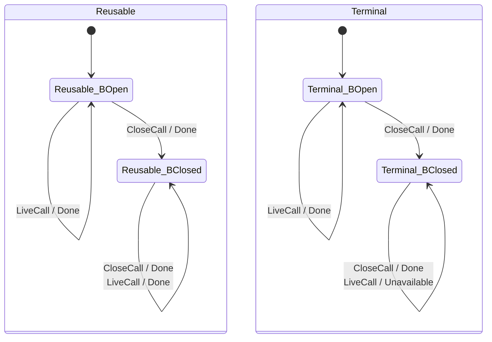
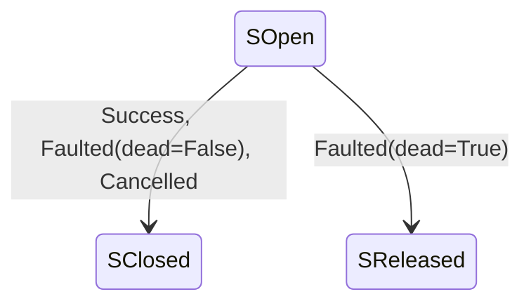
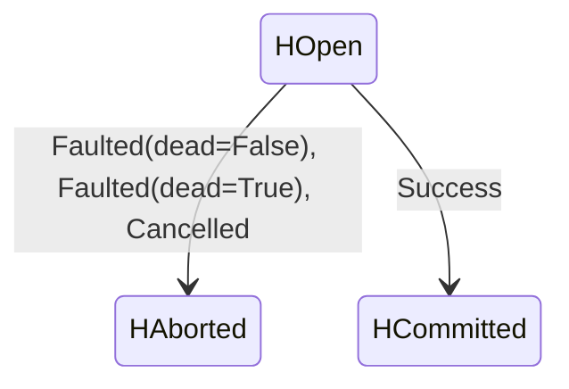
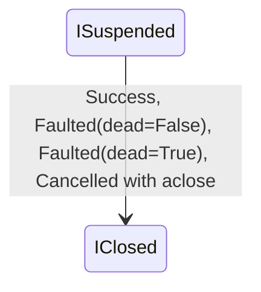

# 052: Backend Lifetime Specification

## Overview

What holds between a backend's calls: the states a backend, and on the contract
kernel its read streams, write handles, listings and the caller's content
iterator, pass through, and who owns each exit. These are lifetime clauses
([`SPEC-DESIGN.md` Rule 2](../SPEC-DESIGN.md#kind-of-truth)): a witness of a
breach is a sequence of calls on one object.

Scope: every backend's close posture (BE-020) and concurrent-use posture
(BE-028), and the interaction protocol of a class on the kernel (BE-033). Out
of scope: one call's outcome against the state when it runs, which is
[spec 003](003-backend-adapter-contract.md)'s, and the contract kernel's single
calls, which are [spec 053](053-contract-kernel.md)'s. Lifetime clauses other
specs own: a `Store`'s sharing across threads (STORE-007,
[spec 001](001-store-api.md)); the async posture and the sync adapter's close
(ASYNC-094, ASYNC-083 and ASYNC-088, [spec 029](029-async-store-backend-api.md));
and a stream on a condemned connection (SIO-010,
[spec 006](006-streaming-io.md)).

## Terms

- **Class on the kernel**, **driver**: as
  [spec 053 § Contract kernel](053-contract-kernel.md#contract-kernel) defines
  them.
- **Close posture**, `close_is_terminal`: as BE-020 defines them.
- **Concurrent-use posture**, `thread_safe`, `single_connection`: as BE-028
  defines them.
- **Live operation**: every member of a backend except the addressing members
  (`native_path`, `to_key`, `resolve`), `name`, `capabilities`, `close` and
  `unwrap`.
- **Closed guard**: after a terminal close (BE-020), the refusal with
  `BackendUnavailable` of every live operation and, on the kernel, of `unwrap`
  too (BE-022); on the kernel it is step 1 of
  [BE-030](053-contract-kernel.md#be-030-key-rule-on-the-kernel)'s pipeline.
- **Condemned**: a failure the driver's `connection_dead` judges a
  transport-level death of the connection, as BE-033's exit-owner table states.
- **`Session`**: the connection owner of a remote driver (RFC-0017 D5). BE-033
  states its obligations and no states for it.

---

## Sections

### BE-020: close()

**Invariant:** `close()` is optional (default no-op). Called for resource cleanup.
**Postconditions:** Whether the instance is reusable after `close()` is the backend's **close posture**, declared by the `close_is_terminal` class attribute:

- `close_is_terminal = False` (the default — a backend need not restate it): the backend re-initialises its clients lazily and remains usable after `close()`. The posture of `LocalBackend`, `MemoryBackend`, `SFTPBackend`, `ReadOnlyHttpBackend`, and the SQL backends.
- `close_is_terminal = True`: `close()` / `aclose()` is **terminal** — the flag flips at the *start* of `close()` and every lazy client accessor guards on it, so a subsequent operation raises `BackendUnavailable` rather than silently re-opening resources the caller cannot observe. The posture of `AzureBackend` (AZ-029), the three S3 backends (S3-019), and `GraphBackend` (GR-051).

The use-after-close conformance lane (`tests/backends/conformance/test_close_posture.py` and its `aio/` sibling) gates on this attribute, asserting the terminal error for terminal backends and re-initialisation for the rest.
**On the kernel:** the closed guard is the kernel's, [BE-030](053-contract-kernel.md#be-030-key-rule-on-the-kernel)'s step 1, and the posture is the driver's `close_is_terminal`. The class's own `close_is_terminal`, which the lane above reads, must match the driver's; the kernel refuses to construct over one that differs. `MemoryBackend` and `AsyncMemoryBackend` are on the kernel, and their drivers declare `close_is_terminal = False`. The states either posture passes through, and who owns each exit, are [BE-033](#be-033-interaction-protocol-on-the-kernel)'s.
**Rationale:** A terminal close turns a use-after-close (a likely bug) into a clear typed error instead of a silent resource reopen, while leaving stateless/cheap backends freely reusable.
**Formal coverage:** `sdd/formal/BackendContract.dfy` models the posture as `closeIsTerminal`, `closed` and `Live()`, with a `Close()` that sets `closed` and promises nothing about the store's contents. Every operation that returns a result, except `RequireCapability`, answers `BackendUnavailable` when `!Live()`, ahead of every other clause and with `fs` unchanged. `Close()` returns nothing and stays callable after a terminal close, and `DropContainer()` models the environment rather than an operation, so neither carries the guard; every other postcondition the other formal-coverage notes in [spec 003](003-backend-adapter-contract.md) quote holds under `Live()`. `MemoryBackendMinimal` is the close-terminal witness in `MemoryBackend.dfy`.

### BE-028: Concurrent-Use Posture

**Invariant:** Every concrete `Backend` declares a **concurrent-use posture**,
one of two values:

- **`thread_safe`** (the default — a backend spec need not restate it): a single
  instance is safe to share across threads, and each `Backend` operation is
  atomic with respect to other operations on the same instance.
- **`single_connection`**: a single instance is **not** safe under concurrent
  use — it wraps a non-thread-safe native client (e.g. one SFTP channel, or a
  `urllib` opener whose redirect counter is shared). Such a backend MUST document
  the posture in its spec **and** class docstring, and MUST state the remedy: one
  instance per thread, or an external serializing wrapper.

No backend provides multi-operation transactionality: atomicity is per-operation
only (MEM-026), and ordering between concurrent callers is not guaranteed.

**Postconditions:**
- `thread_safe` is the posture of `LocalBackend` (stateless; delegates to
  `os`/`shutil`, serialised by the operating system), `MemoryBackend` (a single
  `threading.Lock`, MEM-025), the cloud and SQL backends (their native clients —
  the boto3/s3fs client, the Azure SDK service clients, the SQLAlchemy
  engine/pool — are documented thread-safe for concurrent per-instance use), and
  `GraphBackend` on the async axis (GR-059).
- `single_connection` is the posture of `SFTPBackend` (SFTP-029) and
  `ReadOnlyHttpBackend` on its default `urllib` transport (HTTP-CONC-001).
- An **undeclared** posture is a contract violation, not a silent default: every
  concrete backend states its posture, or inherits the `thread_safe` default by
  the terms of this clause (`LocalBackend`, which has no numbered spec, is
  `thread_safe` by this paragraph).

**Rationale:** STORE-007 promises a `Store` is "safe to share across threads,"
but a `Store` is immutable and merely delegates — the guarantee bottoms out in
the backend. This clause turns "thread-safe" from an unstated assumption into an
explicit per-backend obligation a caller can read from the spec without reading
source. Like CAP-007's quality flags, declaring the posture gates no method; it
documents a property every method has. The posture is the authoritative source
for the machine-readable `concurrency` registry field the cross-backend
concurrency conformance lane tests against.

**See also:** [001-store-api.md](001-store-api.md) (STORE-007),
[013-memory-backend.md](013-memory-backend.md) (MEM-025/026),
[029-async-store-backend-api.md](029-async-store-backend-api.md) (ASYNC-094);
a `close` racing in-flight calls on the kernel, [BE-033](#be-033-interaction-protocol-on-the-kernel).

### BE-033: Interaction Protocol on the Kernel

**Invariant:** a class on the kernel, its driver and the caller pass through the
states tabled below, a call means what the transition table says in each state,
and every exit, failure and cancellation included, has one owner who closes,
aborts or releases what is open. Three invariants hold on every path: a terminal
close absorbs every later call the closed guard covers (I1), every `close` reaches the
driver, so a repeated one is the driver's to make idempotent (I2), and on every
exit the kernel observes it leaves no write handle open, no read stream open
but one a condemned connection releases, and no caller iterator with `aclose`
suspended (I3); the temporary of a temp-and-rename write
is the kernel's too, by the exit-owner row below, outside the model. The other clauses of [spec 003](003-backend-adapter-contract.md) and
[spec 053](053-contract-kernel.md) state each call; this one states the states between them.

**Scope.** The session-less classes on the kernel, such as `MemoryBackend` and
`AsyncMemoryBackend`. A `Session` (RFC-0017 D5) has an interface here and no
states; its obligations below bind it.

**States.**

| Party | States | Leaves a state by |
|---|---|---|
| backend | Open, Closed | `close`/`aclose`; nothing leaves Closed: under `close_is_terminal = False` the driver re-initialises on the next call and the backend stays Closed (BE-020) |
| read stream | Open, Exhausted, Failed, Closed, Released | reading to the end, a mapped stream error, `close`/`aclose`; a Failed stream whose error `connection_dead` condemns is Released, let go without a close (the model's `SReleased`) |
| write handle (`open_write`) | Open, Committed, Aborted | `commit`; `abort` on any exception |
| listing | Not started, Paging, Done, Failed | the first `next`, the last page, a refusal |
| caller's async content iterator | Unstarted, Suspended, Exhausted, Closed | each chunk the kernel takes; its end; the kernel's `aclose` |
| `Session` | not stated here | — |

A sync caller's content is a stream, not an iterator, and has no row: it stays
the caller's in every state (below).

**Transitions.** Per call, in the backend's state:

| Call | Open | Closed, `close_is_terminal = False` | Closed, `close_is_terminal = True` |
|---|---|---|---|
| a live operation (every member BE-030's pipeline runs) | its own clause | as Open, the driver re-initialising | `BackendUnavailable`, after the capability gates BE-030 orders ahead of it; no driver call |
| `unwrap` | the driver's handle, or BE-022's `CapabilityNotSupported` | as Open | `BackendUnavailable` |
| `close`/`aclose` | to Closed; forwarded | forwarded again | forwarded again |
| `name`, `capabilities`, `native_path`, `to_key`, `resolve` | answered | answered | answered, never refused (BE-030's **Addressing stays total**) |

For a read stream: reading to the end leaves it Exhausted, and its close is the
kernel's (async) or the caller's (sync, the `BinaryIO` it was handed). A mapped
stream error leaves it Failed; a Failed stream is closed unless the driver's
`connection_dead` condemns the error, and then it is released without a close,
so no second wait falls on a dead connection (SIO-010), in both runtimes, for
`read` and for `read_bytes`, which drains and closes its stream itself. Read
after close: the sync stream raises `ValueError`, and an async iterator closed
by its caller ends.

**Exit owners.**

| Exit | Owner | What it does |
|---|---|---|
| a repeated `close` | the driver | is idempotent; the kernel forwards every call and short-circuits none |
| a read stream's close that fails after a successful read | the kernel's stream adapter | the close failure is logged, never raised, and fed to `connection_dead`; a read failure outranks a close failure |
| end of data | the driver | exhaustion is the client's own end-of-data read, after any length or checksum check the client makes there, never a byte count the driver keeps |
| a write handle on any exception, cancellation included | the kernel | calls `abort`; an `abort` that fails is logged on `remote_store._kernel` at `WARNING` with its `connection_dead` verdict, and the write's own error is raised |
| a temporary of the temp-and-rename write | the kernel | deleted on any exception; a failed delete is logged as a failed `abort` is, except one that maps to `NotFound` (BE-021, a `container_absent` answer included): no temporary was left, so there is nothing to clean up |
| `abort` after a failed `commit` | the driver | is legal and idempotent |
| an overwrite conflict without `overwrite` | the driver | refuses in one step on the wire where the wire has a conditional write; the conflict surfaces at `commit` for a handle, at the call for `put`; its typing as `AlreadyExists` is a driver duty |
| a caller's async content iterator the kernel stops taking (a refused chunk, a driver or handle failure, a cancel, or a success whose driver returned before its end) | the kernel | calls its `aclose`, when it has one, before the call returns; what that raises is logged and never replaces the write's error. An exhausted one needs nothing. The kernel takes the iterator with its first chunk: a refusal before that, at the gates (closed guard, key, metadata, content shape), a write check or the driver, leaves it unstarted and the caller's to retry with |
| a sync caller's content stream | the caller | the kernel never closes it, on any exit: the caller may seek it or retry with it |
| a connection a failure condemns | the `Session` | `invalidate` closes the client at once, and a stream on it fails mapped at its next read. `connection_dead` means transport-level death, the socket or session gone, never an error the next request on the same connection survives. A cancel never invalidates |
| `unwrap` on a `Session` driver | the `Session` | goes through `run`, so after `invalidate` it reconnects |
| a `close` racing in-flight calls on a `thread_safe` class (BE-028) | the `Session` | creating and tearing down the client is atomic against the closed flag, under a lock held around the accessor alone, never over I/O, and async re-checks after its connect await; `close` waits for no in-flight call, and the teardown wakes blocked calls, which fail mapped. On a `single_connection` class concurrent `close` is already the caller's misuse |

**Refusal timing.** The rule: a pure refusal (the closed guard, a capability
gate, `InvalidPath` for a malformed key) surfaces at the call; a stream's I/O
refusal (`NotFound`, `InvalidPath` for a file-versus-folder mismatch) surfaces
when the stream opens, through a handle (`with`/`async with store.read(...)`);
a listing's I/O stays lazy, at its first page.

**Invariants**, each a lemma of `sdd/formal/KernelProtocol.dfy`:

1. **I1, terminal absorption** (`TerminalCloseAbsorbs`): from Closed under
   `close_is_terminal = True`, every live operation and `unwrap` answers
   `BackendUnavailable`, past any capability gate BE-030 ranks ahead of the
   guard, and the state stays Closed. `close` and the addressing members are
   not refused (the transition table). A non-terminal backend is never refused
   for being closed (`ReusableNeverRefuses`).
2. **I2, `close ∘ close = close`** (`CloseIsForwardedAndIdempotent`): two closes
   leave the backend as one does, and the driver sees each.
3. **I3, cleanup on every exit the kernel observes** (`CleanupOnEveryExit`, over
   `KernelExit`): after any exit, no write handle is Open; every read stream is
   closed, except one whose failure condemned the connection, which is released
   without a close; and no caller iterator the kernel took is Suspended if it
   has `aclose`. One without `aclose` is left where the kernel stopped taking
   it, the caller's to finish. A sync read hands its stream to the caller
   open, so that stream's exit is the caller's close, which the kernel's
   wrapper turns into the close or the release.

**Guard order.** Which capability gates run ahead of the closed guard is
BE-030's **Gates around the pipeline**, and this clause keeps that order.

**The model is the oracle.** `KernelProtocol.dfy` compiles to
`sdd/formal/KernelProtocol-py/`, and `tests/_kernel/test_protocol_oracle.py`
drives the kernel through the exits its case builders enumerate (`_write_cases`,
`_UNDRAINED_ROUTES`, `_open_atomic_cases`, `_read_cases`, `_sequences`; that file
is the list), not every exit and not every state the model admits (most admitted
states pair resources no single exit holds). The writes run on a hierarchical
namespace with `overwrite=True` and an unnested key, and fault only the driver
steps the builders name; a step reached but never faulted, and an exit never
reached, is outside the suite: for example a failed `abort` or a failed delete
of the temporary (both pinned in `test_protocol.py` instead), the probes after a
refusal, `ensure_parents`, the metadata, content-shape and capability gates, a
refused open of a read, or a flat namespace. Each cell but the read's closed
guard, which asserts that no stream was opened, requires the state the kernel
left to equal what the compiled `KernelExit` or `KernelStep` computes from the
state at the exit, so I1 to I3 hold of the code on these exits to the extent
that suite's stated mapping from the fake driver's records onto the model's
states is faithful.

**The model drawn.** The diagrams below are enumerated from the same compiled
model, over every value of its datatypes that `KernelExit`'s preconditions
admit, and a test holds every drawn edge, label included, to one the oracle
suite drives the kernel through; `hatch run gen-protocol-diagram` rewrites
them after the oracle is rebuilt, and `preflight` fails while they are stale.

<!-- BEGIN_GENERATED:kernel_protocol -->
Generated from the compiled model by `scripts/gen_protocol_diagram.py`; do not edit by hand.

The backend under `KernelStep`, each edge a call / its answer:

Each resource under `KernelExit`, each edge labelled with the exits that make it; an exit not drawn
leaves the resource as it was:

Stream:

Handle:

Iterator:

<!-- END_GENERATED:kernel_protocol -->

**Conformance:** `tests/_kernel/test_protocol.py`, a cell per kernel- and
caller-owned row of the tables above over the fake driver, both runtimes
(except the `Session` and driver rows, below, and the stream adapter's
close-failure row); `tests/_kernel/test_protocol_stateful.py`,
a Hypothesis state machine checking I1 to I3 under random interleavings of
`write` and the wire-temporary `write_atomic` route, reads and closes, per
runtime and posture; Memory's rows in `tests/backends/memory/test_kernel_cells.py`;
and the repeated-close cell in both close-posture lanes
(`tests/backends/conformance/test_close_posture.py` and its `aio/` sibling). The
`Session` rows have no cell. The driver's rows are
duties its protocols' docstrings state (`remote_store._kernel._async.driver`),
and no cell checks them.

---

## Assumptions

None lifted out of the sections: BE-028 states, in its own text, what it relies
on from the native clients.

## Notes

The sections carry their derived claims in place: BE-033's Invariants name the
`KernelProtocol.dfy` lemma behind each of I1 to I3, its diagrams are a view
generated from the compiled model, and BE-028's Rationale states STORE-007's
dependence on it.

## Tested against

- The Dafny models `sdd/formal/BackendContract.dfy` and `RootPath.dfy`,
  verified in `MemoryBackend.dfy`, and `sdd/formal/KernelProtocol.dfy` with its
  compiled oracle:
  `bash scripts/dafny_verify.sh BackendContract.dfy RootPath.dfy MemoryBackend.dfy KernelProtocol.dfy`.
- Every test file carrying a BE-020, BE-028 or BE-033 mark, both runtimes:
  `python scripts/run_tests.py $(rg -l 'mark\.spec\([^)]*"BE-0(20|28|33)"' tests)`.

Which test or model clause checks which section derives from the tests' spec
marks and the models' `@spec` tags.
